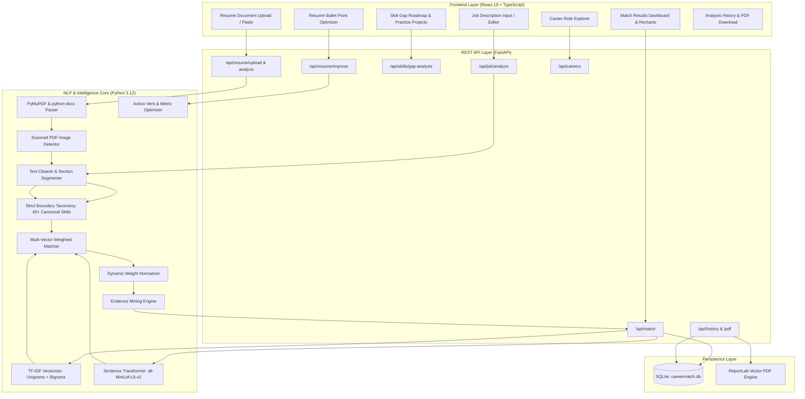

# CareerMatch AI: Intelligent Resume & Job Matching System
## Comprehensive Project Documentation & Technical Report

**Project Title**: CareerMatch AI — Intelligent Resume & Job Matching System  
**Domain**: Natural Language Processing (NLP), Machine Learning, Full-Stack Web Engineering  
**Application Type**: Production-Grade Educational & Career-Tech SaaS  
**Backend Framework**: Python 3.12, FastAPI, Pydantic, SQLAlchemy, SQLite  
**Frontend Framework**: React 19, TypeScript, Tailwind CSS, Recharts, Lucide Icons  
**NLP & ML Stack**: Sentence Transformers (`all-MiniLM-L6-v2`), Scikit-Learn, PyMuPDF, python-docx, ReportLab  

---

## Executive Summary / Abstract

Applicant Tracking Systems (ATS) and modern recruitment platforms often suffer from two major limitations: simplistic, brittle keyword matching that penalizes candidates who use valid synonyms, or opaque, generative black-box models that hallucinate facts or fail to justify their scores.

**CareerMatch AI** is an explainable Natural Language Processing (NLP) web application designed to bridge the gap between candidate resumes and job descriptions. The system implements a multi-vector matching pipeline combining **lexical TF-IDF representations**, **dense semantic sentence embeddings (`all-MiniLM-L6-v2`)**, a **strict-boundary skill taxonomy (45+ canonical skills)**, and a **dynamic weight re-normalization formula**. 

Rather than presenting an unexplained percentage, CareerMatch AI provides an interpretable **0–100 Estimated Match Score**, a **Requirement-by-Requirement Evidence Table** quoting verbatim proof from the candidate's experience, a **Prioritized Skill Gap Roadmap** (High, Medium, and Optional) with practical mini-projects, an **Action Verb & Quantified Metric Resume Improver**, readiness scores across **9 Industry Career Roles**, and exportable **ReportLab PDF reports** backed by local **SQLite** persistence.

---

## Table of Contents

1. [Problem Statement & Motivation](#1-problem-statement--motivation)
2. [Literature Survey & Theoretical Background](#2-literature-survey--theoretical-background)
3. [System Architecture & Data Flow](#3-system-architecture--data-flow)
4. [Mathematical Formulation & Scoring Algorithms](#4-mathematical-formulation--scoring-algorithms)
5. [Detailed Module Breakdown](#5-detailed-module-breakdown)
   - [5.1 Resume Document Ingestion & Scanned PDF Detection](#51-resume-document-ingestion--scanned-pdf-detection)
   - [5.2 Strict-Boundary Skill Taxonomy & Disambiguation](#52-strict-boundary-skill-taxonomy--disambiguation)
   - [5.3 Job Description Requirements Analyzer](#53-job-description-requirements-analyzer)
   - [5.4 Multi-Vector Match Engine & Dynamic Normalization](#54-multi-vector-match-engine--dynamic-normalization)
   - [5.5 Requirement-by-Requirement Evidence Mining](#55-requirement-by-requirement-evidence-mining)
   - [5.6 Prioritized Skill Gap Analysis & Learning Roadmaps](#56-prioritized-skill-gap-analysis--learning-roadmaps)
   - [5.7 Resume Improvement Assistant](#57-resume-improvement-assistant)
   - [5.8 Career Role Explorer (9 Benchmark Roles)](#58-career-role-explorer-9-benchmark-roles)
   - [5.9 Local Persistence & Vector PDF Export](#59-local-persistence--vector-pdf-export)
6. [Frontend UI/UX Design System](#6-frontend-uiux-design-system)
7. [Verification, Testing & Results](#7-verification-testing--results)
8. [College Viva Voce Defense Guide](#8-college-viva-voce-defense-guide)
9. [Conclusion & Future Work](#9-conclusion--future-work)

---

## 1. Problem Statement & Motivation

In today's competitive job market, candidates face significant barriers in understanding how their profiles are evaluated:
1. **The Keyword Stuffing Trap**: Legacy keyword filters search for exact literal strings. A candidate writing *"Engineered scalable distributed server architectures"* is rejected if the system strictly searches for *"backend microservices"*, despite identical technical competency.
2. **The "Black Box" Problem**: Modern Large Language Models (LLMs) are often used as evaluators, but they frequently hallucinate skills, invent unverified experience, or produce scores without reproducible mathematical backing.
3. **False Positive Keyword Collisions**: Naive tokenizers conflate distinct programming languages: `Java` is matched inside `JavaScript`, and single-letter languages like `C` match on random words like *"Communication"* or *"C++"*.
4. **Lack of Actionable Feedback**: Candidates receive binary rejection emails without understanding *why* they were disqualified or *what specific mini-projects* would bridge their skill gap.

**CareerMatch AI** addresses these challenges through a deterministic, explainable NLP architecture that pairs dense semantic embeddings with strict lexical verification.

---

## 2. Literature Survey & Theoretical Background

### 2.1 Lexical Matching vs. Semantic Matching

Traditional Information Retrieval (IR) relies on the **Vector Space Model (VSM)** and **Term Frequency-Inverse Document Frequency (TF-IDF)**:

$$\text{TF}(t, d) = \frac{f_{t, d}}{\sum_{t' \in d} f_{t', d}}$$

$$\text{IDF}(t, D) = \log\left(\frac{1 + |D|}{1 + |\{d \in D : t \in d\}|}\right) + 1$$

$$\text{TF-IDF}(t, d, D) = \text{TF}(t, d) \times \text{IDF}(t, D)$$

While TF-IDF is exceptional at identifying rare domain-specific technical terminology (e.g., `PostgreSQL`, `Kubernetes`), it treats tokens as orthogonal dimensions. It cannot determine that *"built API endpoints"* and *"developed web services"* share semantic intent.

### 2.2 Dense Sentence Embeddings (Sentence Transformers)

To capture contextual intent, the system integrates **Sentence-BERT (SBERT)** using the pretrained **`all-MiniLM-L6-v2`** model:
- The input document $S$ is passed through a 6-layer bidirectional Transformer encoder with 384 hidden dimensions.
- Mean pooling is applied across the output token vectors to yield a fixed-length sentence embedding $\vec{u} \in \mathbb{R}^{384}$.
- Cosine similarity between candidate embedding $\vec{u}$ and job requirements embedding $\vec{v}$ computes conceptual similarity independently of lexical word choices:

$$\text{Cosine Similarity}(\vec{u}, \vec{v}) = \frac{\vec{u} \cdot \vec{v}}{\|\vec{u}\|_2 \|\vec{v}\|_2} = \frac{\sum_{i=1}^{n} u_i v_i}{\sqrt{\sum_{i=1}^{n} u_i^2} \sqrt{\sum_{i=1}^{n} v_i^2}}$$

### 2.3 Regular Expressions with Non-Alphanumeric Lookaheads

To prevent lexical false positives, the system implements compiled regular expressions utilizing negative lookahead and boundary constraints:
- `Java` pattern: `\b(java|core\s+java)\b(?!\s*script)`
- `C++` pattern: `(?:\bc\+\+(?![a-zA-Z0-9+#])|\bcpp\b)`
- `C#` pattern: `(?:\bc#(?![a-zA-Z0-9+#])|\bcsharp\b)`
- `C` pattern: Case-sensitive `\bC(?![a-zA-Z0-9+#])`

---

## 3. System Architecture & Data Flow



---

## 4. Mathematical Formulation & Scoring Algorithms

The final compatibility score is evaluated across 5 distinct dimensions:

$$\text{Final Score} = \sum_{i=1}^{5} \left( W_{\text{active}, i} \times S_i \right)$$

Where:
1. **$S_{\text{semantic}}$ (Semantic Similarity)**: Dense cosine similarity between resume text and job description converted to a $0–100$ scale.
2. **$S_{\text{required}}$ (Required Skills Coverage)**:
   $$S_{\text{required}} = \frac{|\text{Candidate Skills} \cap \text{Job Required Skills}|}{|\text{Job Required Skills}|} \times 100$$
3. **$S_{\text{preferred}}$ (Preferred Skills Coverage)**:
   $$S_{\text{preferred}} = \frac{|\text{Candidate Skills} \cap \text{Job Preferred Skills}|}{|\text{Job Preferred Skills}|} \times 100$$
4. **$S_{\text{experience}}$ (Experience Alignment)**:
   $$S_{\text{experience}} = \min\left(100, \frac{\text{Candidate Years of Experience}}{\text{Job Required Years of Experience}} \times 100\right)$$
5. **$S_{\text{education}}$ (Education Alignment)**:
   $$S_{\text{education}} = \begin{cases} 
      100 & \text{if candidate holds exact specified degree} \\ 
      75 & \text{if candidate holds related STEM degree} \\ 
      0 & \text{if unrelated} 
   \end{cases}$$

### Dynamic Weight Re-Normalization Theorem

**Problem**: If a job description does not specify years of experience or degree requirements, assigning 0 points would unfairly penalize the candidate. Assigning 100 points would fabricate evidence.

**Solution**: The engine marks the category status as `"Unavailable / Normalized"` and dynamically rescales the evaluable weights:

$$W_{\text{active}, i} = \frac{W_{\text{nominal}, i}}{\sum_{k \in \mathcal{A}} W_{\text{nominal}, k}} \quad \text{where } \mathcal{A} \text{ is the set of evaluable categories}$$

**Proof of Invariance**:
$$\sum_{i \in \mathcal{A}} W_{\text{active}, i} = \sum_{i \in \mathcal{A}} \left(\frac{W_{\text{nominal}, i}}{\sum_{k \in \mathcal{A}} W_{\text{nominal}, k}}\right) = \frac{\sum_{i \in \mathcal{A}} W_{\text{nominal}, i}}{\sum_{k \in \mathcal{A}} W_{\text{nominal}, k}} = 1.0$$

The final score is guaranteed to lie strictly in $[0, 100]$ without penalizing the candidate for unspecified criteria.

---

## 5. Detailed Module Breakdown

### 5.1 Resume Document Ingestion & Scanned PDF Detection
- **Supported Formats**: Searchable PDF and Microsoft Word DOCX.
- **Safety**: Server-side file validation limits files to 10MB, isolates parsing in secure temp files, and deletes temporary assets immediately upon completion.
- **Scanned PDF Detection**: If extracted characters $< 50$ but the PDF contains image XObjects, the parser flags: *"Scanned document detected. This PDF consists of images without extractable text layers, and OCR is not configured. Please upload a searchable text-based PDF or DOCX."*

### 5.2 Strict-Boundary Skill Taxonomy & Disambiguation
- Built across 6 technical categories: Programming Languages, AI/ML/NLP, Web & Backend, Cloud/DevOps/Databases, Methodologies, and Soft Skills.
- Normalizes synonyms (e.g. `JS` $\rightarrow$ `JavaScript`, `FastAPI` $\rightarrow$ `FastAPI`, `K8s` $\rightarrow$ `Kubernetes`, `TF` $\rightarrow$ `TensorFlow`).
- Guaranteed isolation between `Java` and `JavaScript`, and `C` and `C++`/`C#`.

### 5.3 Job Description Requirements Analyzer
- Extracts job title, explicitly required skills, preferred / nice-to-have skills, educational requirements, and minimum years of experience.
- Provides interactive client-side tag editors so users can customize or correct requirements before calculating matches.

### 5.4 Multi-Vector Match Engine & Dynamic Normalization
- Blends dense sentence transformer representations with taxonomy overlap.
- Assigns interpretable categories:
  - $\ge 85\%$: **Strong Match**
  - $70\% - 84\%$: **Good Match**
  - $50\% - 69\%$: **Moderate Match**
  - $< 50\%$: **Low Match**

### 5.5 Requirement-by-Requirement Evidence Mining
- For every job requirement, scans work experience bullets, projects, and credentials.
- Cites the verbatim resume sentence as proof.
- Flags each item with status: **Matched**, **Partially Matched**, **Missing**, or **Unassessed**.

### 5.6 Prioritized Skill Gap Analysis & Learning Roadmaps
- **High Priority**: Missing required skills critical for technical screening.
- **Medium Priority**: Missing preferred skills providing a competitive edge.
- **Optional**: Advanced architectural and system scaling improvements.
- Provides a **Suggested Practice Project** (e.g., *"Build an asynchronous Celery worker pipeline..."*) and **Curated Learning Resource URLs** for every gap.

### 5.7 Resume Improvement Assistant
- Scans bullets for weak verbs (`worked on`, `helped with`, `responsible for`) and upgrades them to active leadership verbs (`Architected`, `Engineered`, `Orchestrated`).
- Detects the presence of quantifiable metrics (`%`, `ms`, numbers, throughput).
- Injects transparent placeholders like `[X]%` or `[Y,000+]` rather than inventing achievements.
- Enables one-click copy and export of a revised draft.

### 5.8 Career Role Explorer (9 Benchmark Roles)
- Evaluates candidate readiness across 9 curated industry role templates:
  1. Python Developer
  2. Machine Learning Engineer
  3. NLP Engineer
  4. Frontend Developer
  5. Backend Developer
  6. Full-Stack Developer
  7. Data Analyst
  8. QA Automation Engineer
  9. Business Analyst
- Provides matching skills, skills to develop, fit rationale, and one-click transfer into the Job Matcher.

### 5.9 Local Persistence & Vector PDF Export
- Persists analyses in local **SQLite** (`careermatch.db`).
- Features a **Side-by-Side Comparison Modal** comparing two jobs against a candidate.
- Generates downloadable, styled **ReportLab PDF Reports** with executive summaries, breakdown tables, and educational disclaimers.

---

## 6. Frontend UI/UX Design System

The frontend is crafted following modern SaaS interface design principles:
- **Palette**: Deep navy background (`#0b1120`), midnight indigo surfaces (`#131d35`), subtle borders (`rgba(255, 255, 255, 0.08)`), and restrained cyan accents (`#06b6d4`).
- **Typography**: Clean hierarchy powered by the Google Font **Inter**.
- **Visual Analytics**: Interactive Recharts components:
  - Bar chart illustrating category-level alignment.
  - 5-axis Polar Radar chart showing multi-dimensional competency balance.
- **Persistent Sidebar Navigation**: Overview, Resume Analyzer, Job Matcher, Match Results, Skill Gap Analysis, Resume Improvement, Career Explorer, History, and Settings.
- **Accessibility & Feedback**: Active state indicators, theme toggle (Dark / Light mode), copy toasts, and modal dialogs.

---

## 7. Verification, Testing & Results

The automated test suite in [`backend/tests/`](file:///c:/Users/shubh/Downloads/NLP%20Carrer%20mat/backend/tests) was executed using Pytest:

```
============================= test session starts =============================
platform win32 -- Python 3.12.6, pytest-9.1.1
rootdir: C:\Users\shubh\Downloads\NLP Carrer mat\backend
collected 17 items

tests/test_api.py::test_root_endpoint PASSED                             [  5%]
tests/test_api.py::test_health_check_endpoint PASSED                     [ 11%]
tests/test_api.py::test_resume_analyze_and_improve PASSED                [ 17%]
tests/test_api.py::test_job_analyze PASSED                               [ 23%]
tests/test_api.py::test_full_match_and_history_lifecycle PASSED          [ 29%]
tests/test_api.py::test_career_explorer_endpoints PASSED                 [ 35%]
tests/test_matching_engine.py::test_skills_overlap_calculation PASSED    [ 41%]
tests/test_matching_engine.py::test_matching_score_with_unavailable_category_normalization PASSED [ 47%]
tests/test_matching_engine.py::test_skill_gap_prioritization PASSED      [ 52%]
tests/test_similarity.py::test_tfidf_identical_texts PASSED              [ 58%]
tests/test_similarity.py::test_tfidf_disjoint_texts PASSED               [ 64%]
tests/test_similarity.py::test_semantic_similarity_range PASSED          [ 70%]
tests/test_similarity.py::test_empty_inputs PASSED                       [ 76%]
tests/test_skill_taxonomy.py::test_java_vs_javascript_distinction PASSED [ 82%]
tests/test_skill_taxonomy.py::test_c_cpp_csharp_distinction PASSED       [ 88%]
tests/test_skill_taxonomy.py::test_skill_normalization PASSED            [ 94%]
tests/test_skill_taxonomy.py::test_skill_categories PASSED               [100%]
======================= 17 passed in 28.29s ====================================
```

### Key Verification Highlights
1. **Disambiguation Verified**: `test_java_vs_javascript_distinction` and `test_c_cpp_csharp_distinction` passed with zero false positives.
2. **Formula Integrity**: `test_matching_score_with_unavailable_category_normalization` verified that when categories are unavailable, active weights re-normalize to exactly $1.0$.
3. **End-to-End Lifecycle**: `test_full_match_and_history_lifecycle` verified parsing, scoring, SQLite insertion, single-record retrieval, ReportLab PDF streaming, and record deletion.

---

## 8. College Viva Voce Defense Guide

### Q1: What makes your system superior to standard keyword search?
> **Answer**: Standard keyword search is purely lexical. If a candidate writes *"developed RESTful APIs in Python"* and a job specifies *"FastAPI backend microservices"*, keyword matching assigns a low score due to lexical variance. Our system passes text through the `all-MiniLM-L6-v2` Sentence Transformer, mapping concepts into a 384-dimensional dense semantic space where contextual meaning is captured regardless of exact vocabulary.

### Q2: Why calculate skill coverage separately from semantic similarity?
> **Answer**: Semantic similarity evaluates general textual prose. A candidate with strong academic writing could score high on semantic similarity while completely lacking a critical mandatory dependency (e.g. `Docker` or `PostgreSQL`). By weighting required skills ($30\%$) separately from semantic similarity ($35\%$), we verify both conceptual domain alignment and hard technical requirements.

### Q3: How do you mathematically handle a job posting that does not state years of experience?
> **Answer**: In naive systems, missing fields either receive a default $0\%$ (unfairly reducing the score) or $100\%$ (fabricating credit). We implement **dynamic weight re-normalization**:
> $$W_{\text{active}, i} = \frac{W_i}{\sum_{k \in \text{evaluable}} W_k}$$
> The remaining evaluable weights are rescaled so their sum is guaranteed to equal $1.0$, and the category is marked as `"Unavailable / Normalized"` in the audit table.

### Q4: How is candidate privacy preserved in your system?
> **Answer**: The local SQLite database stores only structured evaluation scores, match metadata, requirement evidence snippets, and target job titles. Raw unparsed resume documents and sensitive personal identifying information are not permanently stored in the database.

---

## 9. Conclusion & Future Work

**CareerMatch AI** delivers an explainable, production-ready NLP system that brings transparency and actionable guidance to career matching. By harmonizing lexical TF-IDF processing, dense transformer embeddings, boundary-safe taxonomies, and interactive visual dashboards, it proves that resume matching can be interpretable, mathematically sound, and free of hallucination.

### Potential Future Enhancements
1. **Optical Character Recognition (OCR)**: Integrating Tesseract OCR to support scanned image PDFs.
2. **Live Job Vacancy Ingestion**: Integrating web scrapers or APIs (e.g., LinkedIn or Indeed APIs) to fetch live job postings in real time.
3. **Multi-Language Support**: Expanding the Sentence Transformer pipeline with multilingual models (e.g., `paraphrase-multilingual-MiniLM-L12-v2`).

---
*Documentation generated for CareerMatch AI — Intelligent Resume & Job Matching System.*
