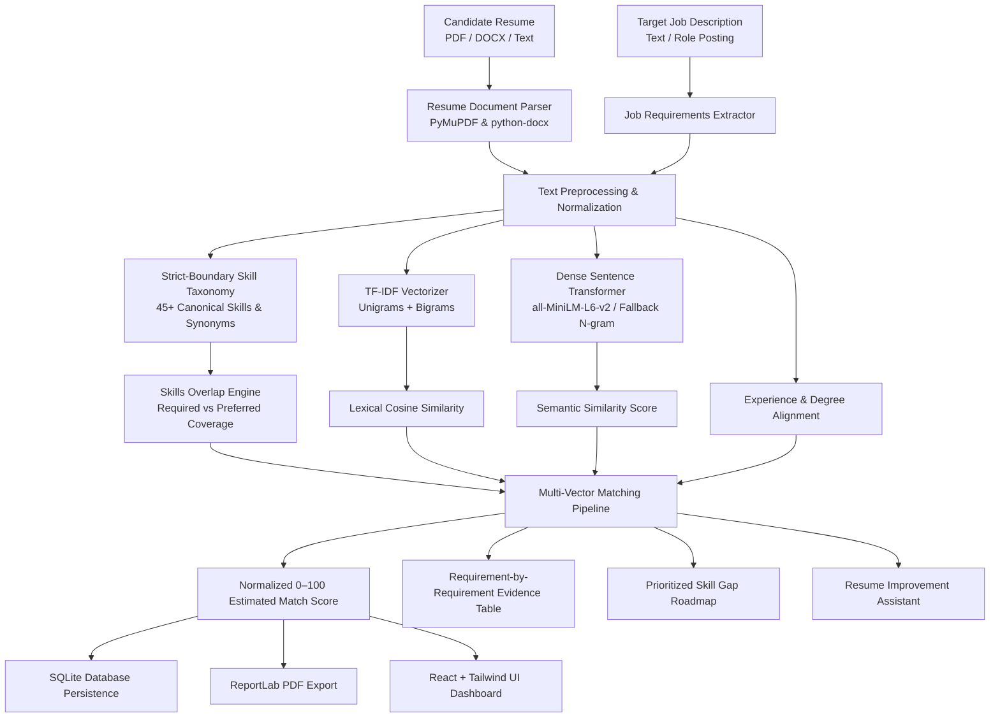

# CareerMatch AI — Intelligent Resume & Job Matching System

CareerMatch AI is a modern Natural Language Processing (NLP) web application that bridges the gap between candidate resumes and industry job descriptions. Built as a college-level NLP engineering project, it emphasizes **explainable machine learning**, transparent multi-vector scoring, semantic embeddings, and an interactive UI.

---

## 1. System Architecture



---

## 2. Key Features

- **Document Ingestion**: Drag-and-drop parsing for searchable PDF and DOCX documents with automated scanned image detection.
- **Strict Skill Disambiguation**: Custom token regex patterns preventing false positives (e.g. `Java` is strictly distinct from `JavaScript`, `C` does not trigger on `C++` or `C#`).
- **Semantic Sentence Embeddings**: Uses pretrained `sentence-transformers/all-MiniLM-L6-v2` to compute dense cosine similarity between resume experience and job requirements.
- **Dynamic Weight Re-normalization**: When an evaluation dimension (e.g., explicit experience years or degrees) is not specified in the job posting, the engine mathematically re-normalizes remaining weights so they sum to 1.0 without penalizing the candidate.
- **Prioritized Skill Gap Roadmap**: Classifies missing skills into *High Priority*, *Medium Priority*, and *Optional Improvements* with concrete project ideas and curated learning links.
- **Resume Improvement Assistant**: Detects weak verbs (`worked on`, `helped with`) and unquantified bullets, providing actionable before-and-after rewrites with transparent placeholders (`[X]%`, `[Y,000+]`).
- **Career Role Explorer**: Matches candidate skills across 9 industry benchmark role templates (Python Developer, ML Engineer, NLP Engineer, Full-Stack, etc.).
- **Persistence & PDF Reporting**: Complete history saved in SQLite (`careermatch.db`) with one-click export to a ReportLab PDF report.

---

## 3. Technology Stack

### Frontend
- **Framework**: React 19 with Vite & TypeScript
- **Styling**: Tailwind CSS (Dark navy / deep indigo palette with cyan highlights)
- **Icons**: Lucide React
- **Data Visualization**: Recharts (BarChart & RadarChart)
- **Build**: Vite

### Backend
- **Framework**: Python 3.12 with FastAPI & Pydantic v2
- **Server**: Uvicorn
- **Database**: SQLite with SQLAlchemy ORM
- **PDF Generation**: ReportLab
- **Testing**: Pytest

### NLP & Machine Learning
- **spaCy & Scikit-Learn**: Tokenization, TF-IDF vectorization, sublinear TF scaling, and cosine similarity.
- **Sentence Transformers**: `all-MiniLM-L6-v2` for dense contextual embeddings.
- **Resilient Fallback Mode**: Gracefully transitions to sublinear character and word N-gram projections if running offline.

---

## 4. Setup and Installation

### Prerequisites
- Python 3.10+
- Node.js 18+ and npm

### Backend Setup
1. Open terminal in the project directory:
   ```bash
   cd backend
   ```
2. Activate or create virtual environment:
   ```bash
   python -m venv venv
   # Windows:
   ..\venv\Scripts\activate
   # Linux/macOS:
   source ../venv/bin/activate
   ```
3. Install dependencies:
   ```bash
   pip install -r requirements.txt
   ```
4. Start the FastAPI server:
   ```bash
   uvicorn main:app --host 127.0.0.1 --port 8000 --reload
   ```
   The backend API will be available at `http://127.0.0.1:8000` (API Docs: `http://127.0.0.1:8000/docs`).

### Frontend Setup
1. Open a new terminal in the project root:
   ```bash
   cd frontend
   ```
2. Install frontend packages:
   ```bash
   npm install
   ```
3. Run the development server:
   ```bash
   npm run dev
   ```
   Open your browser to `http://127.0.0.1:5173/`.

---

## 5. College Viva / Technical Interview Preparation

### Q1: How does the system calculate semantic similarity between a resume and a job description?
**Answer**:
1. The text is preprocessed and cleaned to preserve technical punctuation (e.g. `C++`, `C#`, `Node.js`).
2. Text blocks are passed into the `all-MiniLM-L6-v2` Sentence Transformer model, which maps sentences into a 384-dimensional dense vector space.
3. Cosine similarity between embedding vectors $\vec{u}$ and $\vec{v}$ is calculated as:
   $$\text{Cosine Similarity} = \frac{\vec{u} \cdot \vec{v}}{\|\vec{u}\| \|\vec{v}\|}$$
4. If running offline or in restricted environments, the system seamlessly falls back to sublinear TF-IDF character and word n-gram projections.

### Q2: Why not just count overlapping keywords?
**Answer**:
Keyword counting fails when candidates use synonyms or equivalent industry terminology (e.g., "JS" vs "JavaScript", "ECMAScript", or "AWS" vs "Amazon Web Services"). Keyword counts also cannot measure contextual semantic relevance or distinguish between *required* and *preferred* criteria.

### Q3: How do you prevent "Java" from matching "JavaScript", or "C" from matching "C++"?
**Answer**:
We utilize custom compiled regex patterns with negative lookaheads and word boundaries:
- For Java: `\b(java|core\s+java)\b(?!\s*script)` ensures any occurrence followed by "Script" is ignored.
- For C: `\bC(?![a-zA-Z0-9+#])` combined with case-sensitivity ensures capital 'C' is matched only when not followed by `+`, `#`, or alphanumeric characters.
- For C#: `(?:\bc#(?![a-zA-Z0-9+#])|\bcsharp\b)`.

### Q4: How are unavailable categories handled in the scoring formula?
**Answer**:
If a job description does not specify years of experience or degree requirements, awarding 0 points would unfairly penalize the candidate. Instead, the engine dynamically recalculates the active weights:
$$W_{\text{normalized}} = \frac{W_i}{\sum_{k \in \text{available}} W_k}$$
This ensures the final score accurately reflects only verified, evaluable dimensions.

---

## 6. REST API Reference

| Method | Endpoint | Description |
|---|---|---|
| `GET` | `/api/health` | Health check & active NLP model mode |
| `POST` | `/api/resume/upload` | Upload & extract PDF/DOCX resume |
| `POST` | `/api/resume/analyze` | Parse raw resume text |
| `POST` | `/api/resume/improve` | Analyze weak verbs & bullet point metrics |
| `POST` | `/api/job/analyze` | Extract skills & criteria from job description |
| `POST` | `/api/match` | Execute full multi-vector matching pipeline |
| `POST` | `/api/skills/gap-analysis` | Generate prioritized gap roadmap |
| `GET` | `/api/careers` | Retrieve 9 sample career role templates |
| `POST` | `/api/careers/match` | Evaluate candidate skills across career catalog |
| `GET` | `/api/history` | List all saved match analyses from SQLite |
| `GET` | `/api/history/{id}` | Retrieve specific analysis details |
| `DELETE` | `/api/history/{id}` | Delete analysis record |
| `GET` | `/api/history/{id}/pdf` | Download ReportLab PDF match report |

---

## 7. Running Automated Tests

All tests can be executed using Pytest:
```bash
cd backend
..\venv\Scripts\pytest tests -v
```
The test suite covers:
- Token boundary extraction & taxonomy disambiguation (`Java` vs `JavaScript`, `C` vs `C++` vs `C#`)
- TF-IDF and semantic similarity bounds
- Match score calculations and weight re-normalization
- Skill gap prioritization
- REST API lifecycle and SQLite database persistence
- PDF report generation
